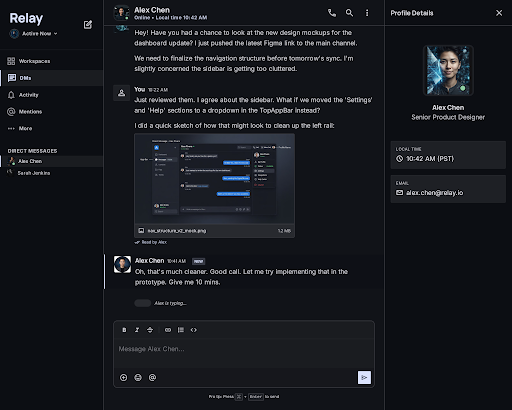
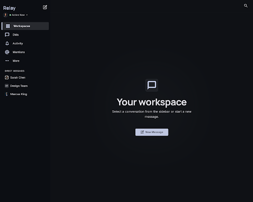
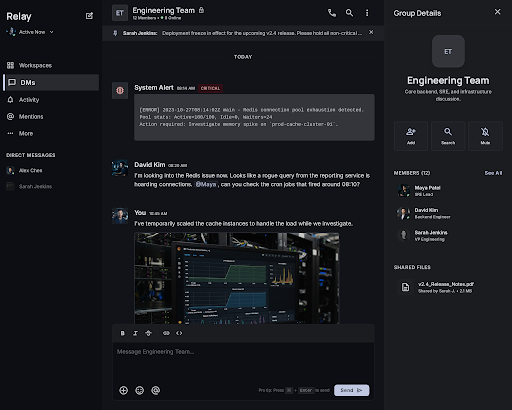
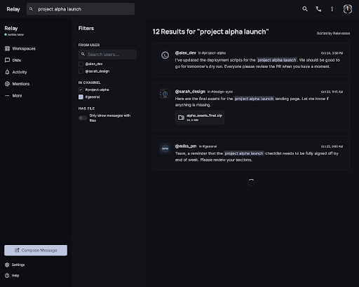
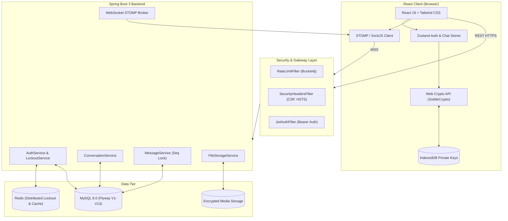
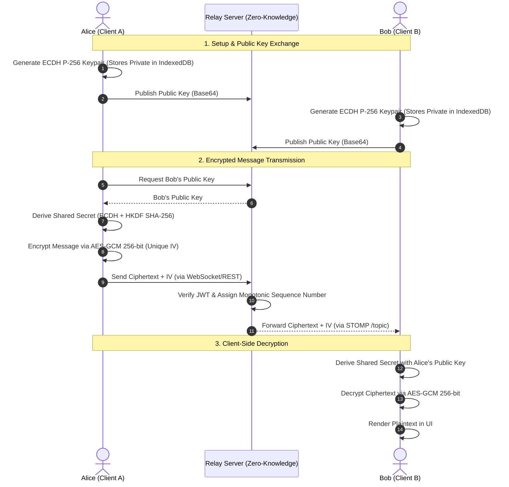

# 💬 Relay — End-to-End Encrypted Real-Time Chat Platform

[](https://openjdk.org/)
[](https://spring.io/projects/spring-boot)
[](https://react.dev/)
[](https://www.typescriptlang.org/)
[](https://vitejs.dev/)
[](https://tailwindcss.com/)
[](https://www.mysql.com/)
[](https://redis.io/)
[](./docs/security/E2EE_SPEC.md)
[](LICENSE)

**Relay** is a high-performance, enterprise-grade, privacy-first real-time messaging application designed with a **Zero-Knowledge Architecture**. All messages, images, GIFs, and file attachments are encrypted client-side using **Web Crypto API AES-GCM 256-bit** authenticated encryption before transmission. The backend server acts strictly as an authenticated zero-knowledge relay, ensuring true confidentiality against server eavesdropping and man-in-the-middle attacks.

---

## 📸 Interface Preview

<div align="center">
  
</div>

<p align="center">
  <em>Modern, responsive interface featuring end-to-end encryption, typing indicators, rich media preview, and user status indicators.</em>
</p>

<details>
<summary><b>🔍 View Additional Screen Previews</b></summary>
<br/>

| Dashboard & Conversations | Group Discussions | Search & Discovery |
| :---: | :---: | :---: |
|  |  |  |

</details>

---

## 🌟 Key Highlights

- **🔒 Zero-Knowledge End-to-End Encryption (E2EE)**:
  - Client-side key generation using **ECDH (P-256 Curve)** via the native `SubtleCrypto` Web API.
  - Ephemeral and conversation keys derived via **HKDF SHA-256** and **PBKDF2** (100,000 iterations).
  - Every message, file, and rich media asset is encrypted with unique **AES-256-GCM** keys and 12-byte initialization vectors (IVs).
  - Private keys remain stored in the browser's **IndexedDB** and are never transmitted to the server.
  - **Safety Numbers / Security Fingerprints** allow users to verify cryptographic identity out-of-band to prevent MITM attacks.

- **⚡ Real-Time Streaming & Presence**:
  - Full-duplex **WebSocket** messaging powered by **STOMP over SockJS**.
  - Monotonically increasing message sequencing per conversation with database concurrency control.
  - Real-time typing indicators with auto-expiring ephemeral subscriptions.
  - User online/offline presence tracking and instant delivery receipts.
  - Conversation-level unread message badge counts.

- **🛡️ Enterprise Security Hardening**:
  - Stateless **Spring Security 6** architecture with short-lived **JWT Access Tokens** (15 mins) and cryptographically hashed **Refresh Tokens** (7 days) with rotation.
  - **Distributed Brute-Force & Credential Stuffing Protection** backed by Redis with instance-scoped in-memory fallback.
  - Multi-tier **Bucket4j Rate Limiting** for registration, login, and message sending endpoints.
  - Strict HTTP Security Headers: Content-Security-Policy (CSP), HSTS, `X-Content-Type-Options: nosniff`, and `X-Frame-Options: DENY`.
  - Startup security validation (`SecurityConfigValidator`) that prevents deployment in production with default credentials.

- **📁 Secure Rich Media Sharing**:
  - Encrypted file upload and storage (Images, GIFs, Audio, Video, Documents).
  - Integrated Tenor GIF Picker with client-side encrypted payload delivery.
  - Secure in-memory decrypted image lightbox with download protection.

---

## 🏛️ System Architecture

### High-Level Architecture



---

### End-to-End Encryption (E2EE) Flow



---

## 💻 Technology Stack

### Backend
| Technology | Version | Purpose |
| :--- | :--- | :--- |
| **Java** | 21 (LTS) | Modern language features, virtual threads ready |
| **Spring Boot** | 3.4.3 | Application core framework |
| **Spring Security** | 6.x | Stateless JWT authentication, RBAC, method security |
| **Spring WebSocket / STOMP** | 3.4.3 | Full-duplex real-time message broadcasting |
| **Spring Data JPA / Hibernate** | 6.x | ORM, query execution, connection pooling |
| **Flyway** | 10.x | Database version control & automated migrations |
| **MySQL Connector/J** | 8.x | Relational persistence |
| **Bucket4j** | 8.10 | High-performance in-memory rate limiting |
| **Spring Data Redis / Lettuce** | 3.4.3 | Distributed authentication lockouts (fail-resilient) |
| **JJWT** | 0.12.6 | HMAC-SHA256 JWT generation and validation |
| **Lombok** | 1.18 | Boilerplate code reduction |

### Frontend
| Technology | Version | Purpose |
| :--- | :--- | :--- |
| **React** | 19.x | Modern UI rendering & reactive state components |
| **TypeScript** | 5.7.x | Static typing and type safety across data contracts |
| **Vite** | 6.2.x | Blazing fast build tooling, HMR, and optimization |
| **Tailwind CSS** | 3.4.x | Utility-first responsive design & dark-mode styling |
| **Zustand** | 5.0.x | Lightweight, decoupled global application state |
| **@stomp/stompjs & sockjs-client** | Latest | Robust WebSocket connection with automatic reconnect |
| **Lucide React** | Latest | Clean, modern iconography |
| **idb-keyval** | 6.x | Browser IndexedDB storage for private cryptographic keys |

---

## 🚀 Getting Started

### Prerequisites

Ensure you have the following installed on your machine:
- **JDK 21** or later (`java -version`)
- **Node.js 18+** & **npm** (`node -v` and `npm -v`)
- **Maven 3.9+** (`mvn -v`)
- **MySQL 8.0+** running locally or in Docker
- **Redis** *(Optional — system automatically falls back to in-memory if Redis is offline)*

---

### 1. Clone the Repository

```bash
git clone https://github.com/Naga0203/relay.git
cd relay
```

---

### 2. Configure Backend

Navigate to `backend/` and configure your environment variables:

```bash
cd backend
cp .env.example .env
```

Review or edit `backend/.env` according to your local environment:

```env
SERVER_PORT=8080

# Database
DB_URL=jdbc:mysql://localhost:3306/relay_chat?createDatabaseIfNotExist=true&useSSL=false&allowPublicKeyRetrieval=true&serverTimezone=UTC
DB_USERNAME=root
DB_PASSWORD=your_mysql_password

# Security & JWT
JWT_SECRET=your-secure-jwt-secret-key-at-least-32-bytes-long
JWT_EXPIRATION_MS=900000
JWT_REFRESH_EXPIRATION_MS=604800000

# CORS & Frontend Origins
CORS_ALLOWED_ORIGINS=http://localhost:5173
FRONTEND_URL=http://localhost:5173

# Redis (Optional)
REDIS_HOST=localhost
REDIS_PORT=6379
```

> **Note**: Database schema tables and seed data are managed automatically via Flyway and JPA upon startup.

Start the Spring Boot backend:

```bash
mvn clean spring-boot:run
```

*The backend will boot up at `http://localhost:8080`.*

---

### 3. Configure Frontend

Open a new terminal window, navigate to `frontend/`:

```bash
cd frontend
cp .env.example .env
npm install
npm run dev
```

*The frontend application will run at `http://localhost:5173`.*

---

### 4. Default Demo Accounts (`dev` profile)

In development mode, two seed accounts are pre-configured for instant testing across separate browser windows:

| User | Email | Username | Password |
| :--- | :--- | :--- | :--- |
| **Alice Johnson** | `alice@example.com` | `alice` | `Test1@234` |
| **Bob Smith** | `bob@example.com` | `bob` | `Test1@234` |

---

## 📡 REST API & WebSocket Endpoints

### Core REST Endpoints

| Method | Endpoint | Description | Auth Required |
| :--- | :--- | :--- | :---: |
| `POST` | `/api/v1/auth/register` | Register new user with age & gender profile | No |
| `POST` | `/api/v1/auth/login` | Login with email or username | No |
| `POST` | `/api/v1/auth/refresh` | Refresh JWT access token with token rotation | No |
| `GET` | `/api/v1/users/me` | Fetch authenticated user profile | Yes |
| `PUT` | `/api/v1/users/me` | Update display name, status, and bio | Yes |
| `GET` | `/api/v1/users/search?q={query}` | Search users by email, handle, or name | Yes |
| `POST` | `/api/v1/conversations` | Create direct message or group conversation | Yes |
| `GET` | `/api/v1/conversations` | List user conversations with unread counts | Yes |
| `POST` | `/api/v1/conversations/{id}/read` | Mark conversation messages as read | Yes |
| `GET` | `/api/v1/conversations/{id}/messages` | Paginated encrypted message history | Yes |
| `POST` | `/api/v1/files/upload` | Upload encrypted attachment | Yes |
| `GET` | `/api/v1/files/{id}` | Download encrypted attachment | Yes |

### WebSocket STOMP Channels

| Destination | Direction | Description |
| :--- | :---: | :--- |
| `/app/chat.send` | Client ➔ Server | Send encrypted message |
| `/app/chat.typing` | Client ➔ Server | Send ephemeral typing event |
| `/topic/conversation.{id}` | Server ➔ Client | Receive new encrypted messages in conversation |
| `/topic/conversation.{id}.typing` | Server ➔ Client | Receive typing status for conversation |
| `/topic/user.{id}.presence` | Server ➔ Client | Online/offline presence notifications |

---

## 🧪 Testing & Verification

Run the comprehensive integration test suite for the backend:

```bash
cd backend
mvn test
```

Build and validate the frontend production bundle:

```bash
cd frontend
npm run build
```

---

## 🛡️ Security Disclosures & Best Practices

- **Zero-Knowledge Design**: The server never holds, sees, or logs plaintext messages or private encryption keys.
- **Environment Isolation**: `.env` and production credential files are strictly excluded via `.gitignore`.
- **Key Safety**: Private keys generated via Web Crypto API are marked non-extractable whenever possible and safely isolated within IndexedDB.

---

## 📄 License

This project is licensed under the **Apache License 2.0** — see the [LICENSE](LICENSE) file for details.

---

<p align="center">
  Crafted with care by <a href="https://github.com/Naga0203">Naga durgarao Thuttupu</a>
</p>
